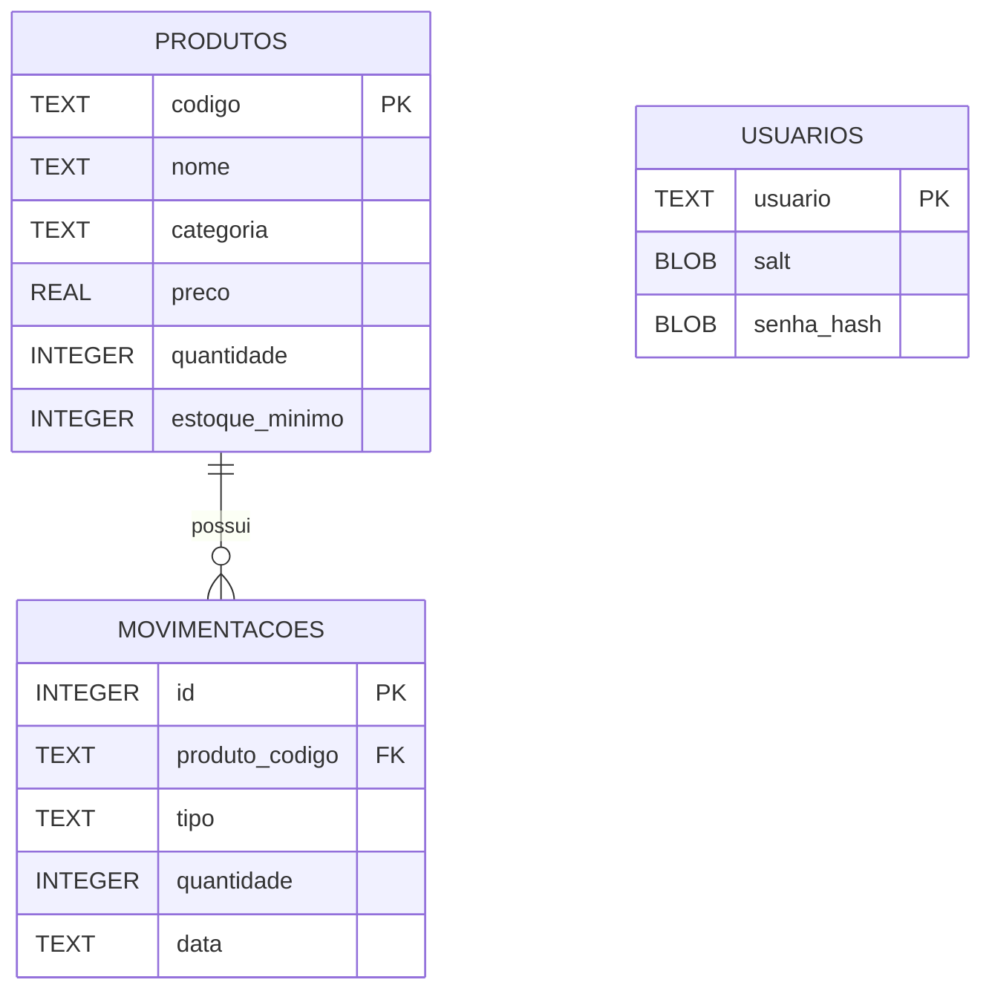

# Sistema de Controle de Estoque

Projeto TAREFA-05 da disciplina INE5201 — Introdução à Ciência da Computação com Python.

Aplicação desktop em Python com interface Tkinter e banco SQLite. Inclui cadastro
de produtos, entradas e saídas, consulta de estoque, alertas, histórico,
relatórios CSV, autenticação, backup automático, dashboard e gráfico de estoque.
O leitor por webcam é opcional.

## Requisitos

- Python 3.10 ou superior, com Tkinter habilitado.
- O SQLite já acompanha as versões usuais do Python.
- Gráficos: `pip install -r requirements.txt`.
- Leitor por webcam: `pip install -r requirements-opcionais.txt` e biblioteca
  nativa ZBar disponível no sistema. Webcam conectada e permissões concedidas.

## Como executar

Na pasta do projeto:

```powershell
python main.py
```

Também é possível iniciar com `python estoque_gui.py`. No primeiro acesso,
cadastre o usuário e uma senha com pelo menos oito caracteres. Não há usuário ou
senha padrão.

## Funcionalidades

- Cadastro, edição e exclusão de produtos com código único, categoria, preço e
  estoque mínimo.
- Registro de entradas e saídas; saídas acima do estoque são recusadas.
- Consulta por categoria, valor total do estoque e destaque de estoque baixo.
- Dashboard de indicadores e gráfico dos produtos com maior quantidade.
- Histórico de movimentações e exportação CSV filtrada por categoria.
- Senhas protegidas com PBKDF2-HMAC-SHA256 e salt aleatório.
- Backup SQLite no início e no encerramento em `backups/` (mantém os 10 mais
  recentes).
- Leitura de códigos de barras pela webcam, quando os opcionais estão instalados.

## Banco de dados

O esquema é criado automaticamente na primeira execução a partir de
[`banco.sql`](banco.sql). O trigger `movimentacao_atualiza_estoque` atualiza a
quantidade do produto quando uma movimentação é inserida. O trigger
`movimentacao_saida_com_estoque` impede saldo negativo.

### Diagrama



## Estrutura

```text
estoque_gui.py
main.py
banco.sql
database/
  conexao.py
  produtos.py
  movimentacoes.py
  usuarios.py
interface/
  login.py
  menu_principal.py
  cadastro_produtos.py
  registro_movimentacao.py
  consulta_estoque.py
  relatorios.py
utilitarios/
  validacoes.py
  exportacao.py
  codigo_barras.py
```

## Testes

Execute os testes automatizados com:

```powershell
python -B -m unittest discover -s tests -v
```
